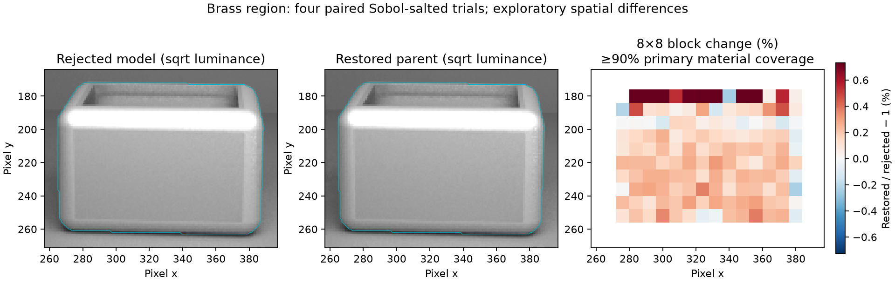
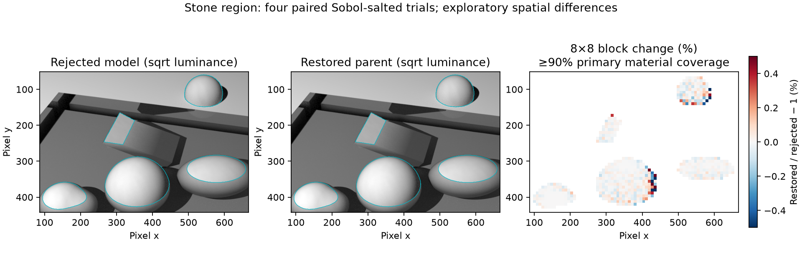

# DL-423 redo: critical-cone angular transport

Design first, 2026-10-13. Base: local master `a8ffe5a4e`.
Status: investigation, not an implemented replacement or closure claim.

## Rejection and restoration

The `818f59609` attempt merged by `04f5412cb` was REJECTED on independent
review. Its constants (4, .18, .55, .2, 8, .50, .1 floor) were fitted rather
than derived. Its design described polar/Fourier solves that the code did
not implement. It introduced an in-plane fan (2.5–5.6 times the composite),
max-kray regressions (1.3→111 and 8→346), furnace variance up to about 20x,
3–4% overcorrection away from tuning cells, a step at F0=.2, and grazing
AOV disagreement. The no-shipped-GGX claim was false: `mat_brass_dry` in
lacquer_and_rain_still_life and `mat_stone_base` in tidal_stones use this path.
The requested merge revert restores CoatedBRDF exactly to `43333616e`.
The old angle-resolved document is removed by that revert; no engine
feature is removed. DL-382 and frozen material implementations are protected.

## Physics and conventions

This design initially concerns an isotropic GGX substrate under an optical-flat
coat. Rough coat normals, anisotropic substrates, textured parameter caches,
and Pel/NM/HWSS behavior require separate validation before shipping.
Snell refraction from outside gives internal cosine
$\mu' = \sqrt{1-(1-\mu^2)/\eta^2} \ge \mu_c=\sqrt{1-1/\eta^2}$.
A perfectly mirror-like substrate retains that cosine. It does not create a
TIR population from externally refracted light. Finite roughness can scatter
energy below the critical cone; only that angular population is trapped.
The mirror series is
$R_s T^2 a^2/(1-R_s F_{in} a^2)$, a delta in both angles.
It is a limiting check, not a finite-roughness BRDF approximation. Finite
roughness return paths compose the lobe at each bounce; they must not be
replaced by an arbitrarily sharpened peak. Validate multi-return angular
spread against one bounce, as well as the fan region.

Directions point away from the substrate. Integration measure is projected
solid angle $d\nu=\mu\,d\omega$. Let R be the substrate reflection operator,
Q the diagonal multiplier $F_{in}(\mu)a(\mu)^2$, and P the azimuth rotation
by pi induced by coat reflection and re-expression as an incident direction.
The internal return operator is
$B=R+R QP R+R QP R QP R+\ldots=R(I-QP R)^{-1}$.
Entry and escape use Snell mappings, both transmissions and one-way Beer
factors; external BRDF conversion must retain the radiance/solid-angle Jacobian.
The directional albedo is its projected-angle integral, not a separately
estimated heuristic. Reciprocity follows term-by-term from reciprocal R and
self-adjoint QP; it must also survive discretization and outer frame mappings.

## Options, before any implementation

(a) Analytic mirror-retained plus cosine-scattered split: exact for a delta
substrate, but no unique nonnegative finite-GGX split is established. GGX
roughness correlates polar and azimuthal angles. A fitted retained fraction
would repeat the rejected approach. Matching energy or one Fourier moment
cannot bound the fan. Do not select without a derived split and error bound.

(b) Full angular return table: split polar quadrature at the exact critical
cosine, Fourier-resolve azimuth, and solve the adding equation for each mode.
For an isotropic substrate, P multiplies mode m by (-1)^m. Use projected
quadrature weights and symmetric representation so reciprocity is structural.
Unlike the rejected code, all retained modes and both polar arguments exist.
Critical-angle splitting is not a physical threshold fitted to data.
Finite resolution needs measured convergence and positivity checks; solving
albedo (mode zero) alone does not validate a bidirectional BRDF or sampler.

(c) Hybrid: retain the exact first bounce and analytic delta limit; represent
only multiple-return angular transport by the table. This avoids tabulating
the first-bounce peak and preserves the existing diffuse paths. It still needs
all angular modes required by the residual, not an assumed wrapped-Cauchy fan.
This is the provisional direction for investigation, not a production choice.

The numerical solve must quantify residual and discretization errors. If a
matrix contraction norm q<1 is certified, truncating after N returns gives a
norm-tail bound proportional to q^(N+1)/(1-q). There is no universal such q:
lossless TIR states have Q=1. Use the actual escape-connected operator and
resolvent residual; never insert a floor to force convergence. Successive
resolution differences are measured estimates, not rigorous global bounds.

The established angular adding approach is supported by Jakob et al.,
[A Comprehensive Framework for Rendering Layered Materials](https://rgl.epfl.ch/publications/Jakob2014Comprehensive).
That paper does not validate this proposed RISE discretization.

## Required joint value/sampler/AOV contract

A production table needs nonnegative reciprocal density, normalized conditional
CDFs in polar and azimuthal angle, and the same interpolated density in value,
Pdf, and Scatter. Any new peak must have sampling support. Albedo is the
integral of that same interpolant. Painter-dependent eta, extinction, GGX
parameters, wavelength and normal frames are cache keys or explicit inputs;
no shared cache may ignore them. Lambertian/Oren-Nayar dispatch is untouched.
No roughness/F0 cutoff or fitted attenuation coefficient is permitted.

Validate the user's full alpha/F0/eta/theta grid, fan wedge, 200k-draw max kray,
furnace SEM, lossless furnace, F0/alpha continuity, K6 at 70–85 degrees,
absolute K4 bands and all named regression suites. The user replaced the
literal fixed-step continuity requirement with shrinking-step tests for value,
Pdf, AOV and integrated directional albedo, plus fine F0/alpha neighbour sweeps.
The restored parent must be tested, and any pre-existing failure reported
without repair in this slice. Keep the independent composite unchanged.

## Measurement plan and stop condition

Reuse the supplied reviewer Probe.cpp, p_* data, render fixtures and cmp.py.
Rebuild restored code, run a fresh restored probe, and distinguish historical
rejected-attempt measurements from current evidence. Offline mode-zero solves
at increasing quadrature resolution can assess albedo convergence only.
A new model cannot ship from those solves: fan, conditional sampling, kray,
reciprocity, full-grid error and all painter/wavelength paths remain required.
If no option has demonstrated those properties within this slice, stop after
the revert and this design with measured limitations. DL-423 stays OPEN.
No candidate engine code is written before this document.

## Measured options and decision

No production candidate is selected in this slice. The permitted STEP 0 +
design outcome is used; DL-423 remains OPEN. A mode-zero full-return pilot
was written only after the physics draft and only outside the engine.
It is not a bidirectional angular table, sampler, AOV correction or cache.

| Option | Measured evidence | Error claim that is justified | Disposition |
|---|---|---|---|
| (a) Analytic retained/scattered split | Exact mirror geometric series is a limiting identity; no finite-GGX retained fraction was derived or measured | Zero approximation error for the stated delta limit; no finite-alpha bound | Not qualified; do not fit a split coefficient |
| (b) Full angular operator | Mode-zero albedo pilot: 25 clear-coat diagnostic cells, F0=.9, alpha .02/.05/.5, eta 1.3/1.5/1.7 in five tuples, theta 0/45/70/80/85 | Worst point estimate +1.450% (alpha .05, eta1.5, theta80); 25/25 within2%. Largest point-error-plus-3SEM reference envelope 4.612% at alpha .05/eta1.5/theta70. No global or angular error bound | Promising albedo only; not sufficient to ship |
| (c) Exact first bounce plus full angular residual | Proposed, not implemented or independently measured | Cannot inherit a full-BRDF/sampling bound from mode zero | Preferred direction for further work, not a selected production implementation |

The 25 cells are not a Cartesian accuracy grid and contain no F0 sweep,
no alpha1 case, and no independent reference at89 degrees. Their reference
uses eight independently RNG-seeded batches of20,000 native composite draws.
An estimated 3SEM envelope is not a rigorous confidence bound or a discretization
bound. The worst prototype point is0.804356 vs reference0.792860, reference
SD0.012730. At70 degrees it is0.793259 vs0.803370, SD0.025400. More reference
samples and full angular validation are needed to certify a2% contract.

Polar resolution is split at the exact critical cosine. For alpha .02/eta1.5,
maximum absolute albedo changes over0/45/70/80/85/89 degrees were:
64→128 nodes0.0122324;128→256 nodes0.000019606;256→512 nodes0.0000003673.
For the other four tuples,64→128 differences were at most0.000018658.
All runs used2048 azimuth strata; no azimuthal convergence bound is claimed.
Linear solve residuals were below2.2e-15. That bounds only the residual of
the discrete solve; it does not bound continuum or Fourier truncation error.
The native substrate kernel's quadrature and energy properties must also be
certified before a lossless full-return operator can claim energy<=1.
No per-row fitted renormalization, floor, Cauchy fan or cutoff is shipped.

The unchanged restored engine's reviewer diagnostic grid has85 cells across
17 selected tuples. Its worst ratio is1.10097 (alpha .05/F0 .9/eta1.5/theta80),
and56/85 (65.88%) point estimates are within2%. The fresh85-degree value in
that tuple is1.05564 +/-0.00951 ratio SE; it does not reproduce the historical
~1.24 scratch figure, so that historical figure is not relabelled as fresh evidence.
The strict existing CoatedGGXAccuracyTest must still fail where the residual
shows. Its default opt-in behavior is unchanged in this rollback-only slice;
the requested future replacement must make the expanded gate default.

## Fan, sample weights and furnace: rollback evidence

Fresh restored runs reproduce the supplied parent measurements. At F0 .9,
alpha .02,200,000 draws: max kray1.33774 at45 degrees and8.02902 at85 degrees.
The rejected measurements are111 and346, respectively. Restoring the parent
removes that rejected regression; it does not repair the parent's DL-423 error.
At alpha .05/theta70, the far in-plane wedge is0.01764 restored vs0.04892
rejected vs0.02126 composite. At alpha .02/theta85 it is0.01237 restored,
with the composite at0.01856: the restored angular shape is still imperfect.
The fan measurements are eight batches of20,000 draws, using the supplied
Probe.cpp's geometry (within5 degrees in azimuth and more than20 in polar
angle). They are not a new green angular gate or a composite-equality claim.

Across the supplied lossless90-cell diagnostic (alpha .02/.05/.1/.3/1,
eta1.3/1.5/1.7, theta0/45/70/80/85/89), restored furnace means span
0.99512..1.01003. A finite noisy probe and the existing63-case furnace gate
are not a proof of energy<=1 everywhere. Fresh AOV/furnace comparisons and
parent/rejected data are retained under[evidence](evidence/dl423-redo/README.md).
No replacement max-kray, variance, AOV or lossless certification is claimed.

## Updated continuity diagnostics

The user withdrew the literal fixed-step0.1% limit. The new diagnostic checks
h=1e-3,1e-4,1e-5 for alpha/F0/eta and value/Pdf/AOV/integrated albedo,
requiring successive d ratios<=.2 and treating relative differences<=1e-12
as zero. Alpha is clamped to[1e-4,1], F0 to[0,1]; sampled eta is1.3/1.5/1.7.
It tests six alpha values, eight F0 values including .199/.2/.201, and eight
directional pairs including near-mirror and grazing. It also sweeps alpha
.002..1 and F0 .02..98 at step.001 on those pairs, comparing each relative
step against the median of up to four neighbouring steps with a10x limit.
Integrated albedo uses256 fixed importance-proposal draws, common across
parameter changes; this is a continuity estimate, not an accuracy proof.

Restored-parent failures are reported, not fixed. The initial diagnostic gave
90,260 passing checks and44 failures: value8, Pdf8, AOV2, integrated albedo26.
All44 occur in the coarse1e-3→1e-4 ratio. Every1e-4→1e-5 ratio and every fine
sweep passed. Most failures occur at alpha .002, where h=.001 is half the
parameter and substantial curvature is expected; two AOV failures occur at
alpha .02/F0 .98/normal view, eta1.3 and1.5. For example, alpha .002/F0 .02/
eta1.5/view85/light83/mirror azimuth has value d=.033867→.013766 and Pdf
.024208→.030673 for the first pair. They fail the requested coarse criterion;
the finer pair shrinks. This evidence does not establish a persistent jump.
The full diagnostic logs locate all failures, with finer ratios printed.
No criterion is loosened and no pre-existing model change is made.

## Look change from rejected model to restoration

These compare the rejected CoatedBRDF object against the restored library,
with every other engine object identical. They measure the rollback, not a
new candidate. Four paired Sobol-salted renders per scene; lights unchanged.
SD below is the sample SD across four trials, not SEM. Material masks use
primary pixel-centre hits with the engine's screen/image row convention.

| Scene/region | Rejected mean +/-SD | Restored mean +/-SD | Paired relative change +/-SD |
|---|---:|---:|---:|
| lacquer, whole | .0684576595 +/-.0000074110 | .0684688187 +/-.0000054219 | +.016301% +/-.003502% |
| brass material | .1811637252 +/-.0000646706 | .1814068939 +/-.0000412364 | +.134230% +/-.016843% |
| tidal, whole | .0891596385 +/-.0000059129 | .0891606064 +/-.0000052060 | +.001086% +/-.002049% |
| stone material | .1745452442 +/-.0000305585 | .1745477451 +/-.0000289631 | +.001433% +/-.001649% |

Eight-by-eight interior block maps use>=90% primary-material coverage:
139 brass blocks (range−.245%..+2.460%, p5/p95−.0855%/+.7296%),
658 stone blocks (−1.116%..+2.993%, p5/p95−.1051%/+.0917%).
These exploratory extrema include sampling noise; no variance improvement
is inferred at n=4. The PNGs were visually checked for region-mask alignment.
Raw block values, corrected summaries, salts and probe source are retained.

## Shipping status

The branch restores the rejected attempt and records this design/evidence.
No replacement estimator or sampler has been implemented. Full replacement
acceptance gates cannot be claimed green; no local merge or push is permitted
on the strength of these pilot numbers. DL-423 stays OPEN. DL-382, frozen
transport/features and lights are unchanged. Reserved IDs DL-610..DL-615
have not been consumed by speculative or duplicate residual rows.

Parent compatibility control: an isolated `43333616e` CoatedBRDF object and
the restored archive give identical combined value/AOV/Pdf/512-draw hashes
for Lambertian (**15861591631066846134**) and Oren-Nayar
(**2137759471982955725**) across eta 1.3/1.5/1.7, extinction 0/.2,
four view angles and sixteen outgoing directions. The rejected object
had the same Lambertian hash but a different Oren-Nayar hash; restoration
compatibility is measured against the requested parent, not against that
rejected object. CoatedBRDF source blob equals the parent's
`adec3800e831fb6129e5a4fa13bed937d4728180`. No diffuse-path retuning occurred.

The supplied lossless furnace data's largest rejected/parent SEM ratio is
**5.650**, at F0=1/alpha .02/eta1.5/theta89 (SEM .00808 vs .00143),
a replicate-variance proxy of **31.93x** at equal n=8. This is a noisy
finite-replicate estimate, not an everywhere variance bound. The fresh
restored probe reproduces the parent; a new model has no claimed weight
or variance result because none is implemented.

## Final rollback validation record

Clean make library/CLI build, clean Xcode Deployment and clean Opto builds
all returned rc0, with no compiler warnings. Only the usual AppIntents
metadata extraction notice appeared. Each named test was built individually
with `build-test/<Name>` and its build rc checked (all0), then run sequentially.

- LayeredWhiteFurnaceTest63/0; CoatedEtaContinuityTest60/0;
  CoatedMaterialChunkTest85/0.
- SPFBSDFConsistencyTest and SPFPdfConsistencyTest: rc0, all checks passed.
- ConnectionTypeSplitTest431782/0; full CompositeEnergyConservationTest1177/0.
- CoatedGGXAccuracyTest `--gate`: rc1,11/19 comparisons pass,8 fail.
  This is the known restored-parent DL-423 residual, not a green replacement.
- CoatedParameterContinuityProbe: rc1,90260/44. All fine shrinking pairs and
  sweeps pass; reported coarse failures are not fixed per the user instruction.

Build logs remain `/tmp/dl423-clean-build.log`, `/tmp/dl423-deployment-build.log`,
`/tmp/dl423-opto-build.log`, and `/tmp/dl423-build-<Test>.log`; test logs and
validation summary are committed with the evidence. The branch is committed
for fresh independent review of rollback integrity and physics/evidence
honesty. This does not claim a clean DL-423 replacement, and no future review
verdict or local merge is assumed. The acceptance failures forbid merging
this as a completed fix; the user's STEP0+design stopping option is honored.
