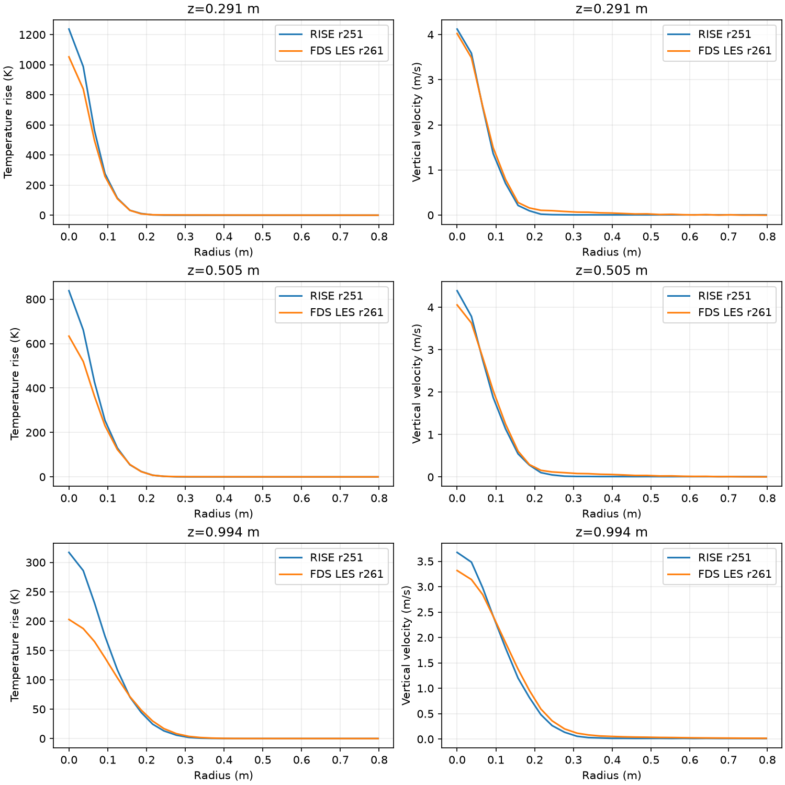
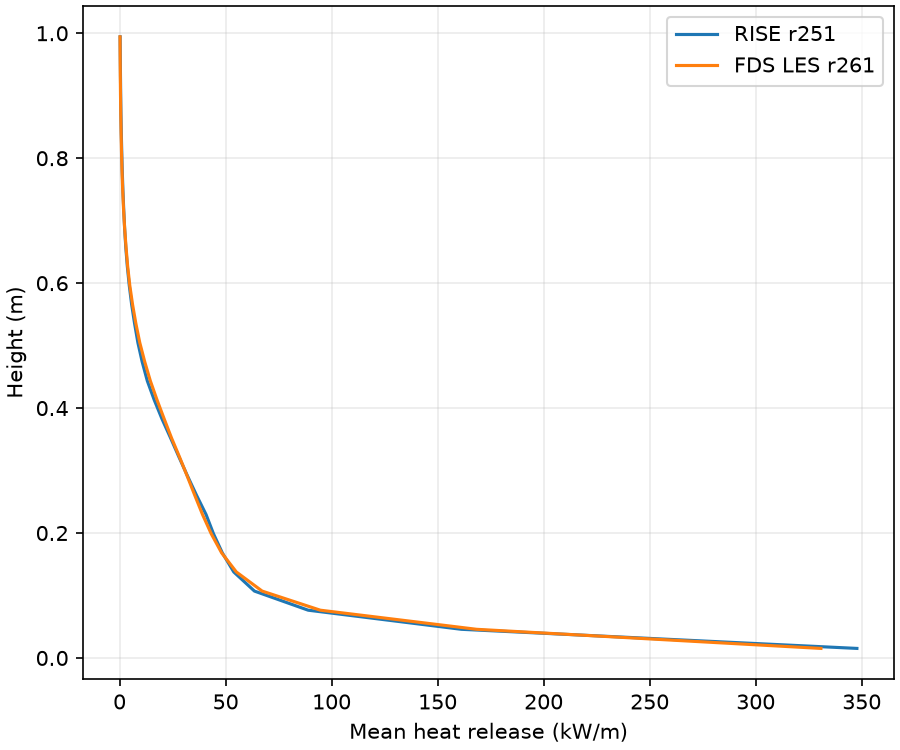

# r262 — combined transport, near-flame comparison and onset safety

Owner accepted r260 and authorized one combined four-second continuation,
read-only comparison with the retained r261 FDS outputs, and from-zero onset
checks of the better centered/combined candidate. Production solver unchanged.

## Execution status

Combined CHARM plus centered momentum is running externally from r251's
step9224 checkpoint, t=15.018720638239756s, to at least19.018720638239756s.
The shared r260 observer compares all accepted Q/T/M/U fields against the
same MC baseline in the first two steps. Both steps differ: first-step maximum
vertical-face velocity difference0.222298m/s; second-step0.406099m/s. The
four-second window proceeds only after that check.

External directory: `/Volumes/SSD/RISE/fire_production_calibration/r262_combined`.
`campaign_status.json` records the bounded serial controller's current stage.
After successful reduction it selects the larger3m mass flux of centered
and combined, then runs that candidate from zero at tier8 through3.5s and
at tier10 through3s, sequentially. Existing stops are60m/s and15m/s,
respectively. These are diagnostic onset checks, not full-window acceptance.
No production adoption follows automatically. An execution failure stops the queue.

Pending: combined entrainment, candidate selection, and both onset maxima.
Measured results will be in `docs/data/fire_r262/results.json` and
`component_comparison.csv`; complete onset trajectories are retained there.

## Boundary audit before onset — material mismatch

The owner requested this read-only audit before onset. The queue was held
while checking; no onset had started. **The wall shear treatment differs.**
The near-base profiles remain measurements of the two runs, but are not a
controlled transport-only comparison and cannot isolate a transport cause.
The RISE-to-RISE A/B and from-zero onset safety comparisons remain meaningful.
No input or solver setting was changed by this audit.

| Item | RISE r251 | FDS r261 | Match? |
|---|---|---|---|
| Floor outside burner | Impermeable, adiabatic wall; normal velocity zero | Default `FLOOR`, `ADIABATIC=T`; no bottom OPEN vent | Yes |
| Floor tangential treatment | No-slip-style reflected ghosts, `u_ghost=-u_cell`; no wall function | Default LES log-law wall model; neither `NO_SLIP` nor `FREE_SLIP` specified | **No** |
| Burner tangential treatment | Zero tangential wall value through reflected ghosts; prescribed normal fuel flux | Burner SURFs retain default LES wall model, with prescribed normal fuel flux | **No** |
| Burner elevation | Bottom face at z=0; first gas center at 0.01530m | All burner vents at z=0; same first gas center | Yes |
| Burner surroundings | Flush mask in flat full-domain bed; no resolved pan, lip or pedestal | Flush vents in flat floor; no OBST/GEOM, pan, lip or pedestal | Yes |
| Side boundaries down to floor | All four sides pressure-open through lowest cell row | Four full-face MB OPEN vents, z=0 through mesh top | Yes |

Evidence: [actual FDS input](data/fire_r261/r261_fds.fds), lines2,6–12
and all burner vents. RISE `tools/fire_simulator_core.h:716–736` defaults
to pressure-open on all sides except the adiabatic bottom. The active
`BindProductionBurnerBoundary` in `tests/FireSequenceTest.cpp:1850–1882`
copies these kinds and places the fuel mask on bottom side4.
`FireProductionForceMac.mm:186–213` reflects cell velocity at walls,
retaining nonzero normal injection only on burner faces. Its stress is
computed from those gradients and molecular plus Vreman viscosity, with no
log-law friction-velocity calculation. The resident transport gradients
use the same zero tangential boundary value in
`FireProductionAdvectionMac.mm:2380–2383,2441–2452`. This describes the
implemented discrete treatment, rather than claiming a resolved physical
viscous sublayer at this coarse grid.

The exact installed FDS6.11.1 source sets `WALL_MODEL_BC` by default in
`Source/read.f90:9687–9690`; DNS or explicit `NO_SLIP` would select the
reflected-ghost alternative. `Source/velo.f90:2368–2387` calls `WALL_MODEL`
for the LES treatment. Its User Guide source, section `info:WALL_MODEL`,
line3592, confirms the LES log-law default and the explicit no-slip override.
These files are under the retained external `r255_comparison/fds_source`
checkout; exact file hashes are in
[boundary_comparison.json](data/fire_r262/boundary_comparison.json).
No claim is made that wall shear causes all or a specified part of the gap;
that has not been tested. No additional matched FDS run is authorized here.

## Near-flame result — existing r251 against full-output LES FDS r261

Statistics window10.4660401272–25.0910401272s. Actual common native cell
heights are0.291/0.505/0.994m. Upward flux integrates positive vertical mass
flux inside radius0.8m; it differs from the net entrainment used in the A/B table.

| Height (m) | RISE upward (kg/s) | FDS upward (kg/s) | RISE deficit | Temperature half-width RISE/FDS (m) | Velocity half-width RISE/FDS (m) |
|---:|---:|---:|---:|---:|---:|
|0.291|0.09301|0.13997|33.6%|0.0621 /0.0634|0.0746 /0.0777|
|0.505|0.14370|0.18472|22.2%|0.0671 /0.0753|0.0832 /0.0933|
|0.994|0.26331|0.31063|15.2%|0.1017 /0.1270|0.1226 /0.1397|

Centerline temperature rise RISE/FDS is1236.7/1051.9K,838.2/633.7K,
and317.0/202.8K. Centerline vertical velocity is4.123/4.025m/s,
4.391/4.057m/s, and3.675/3.318m/s. At0.29m the widths and center velocity
are close; by0.5m RISE is narrower in both fields and hotter, with further
separation by1m. The mass-flow difference already exists inside the flame.
This comparison locates the difference; it does not establish its cause.

The vertical mean heat distribution is very similar: below1m it integrates
to32.835kW in RISE and32.957kW in FDS. Of that heat,84.88/84.27% lies
below0.3m,96.20/96.10% below0.5m, and99.15/99.24% below0.7m.
Mean heat-release height below1m is0.1385/0.1409m. The entrainment and
width differences coexist with closely matched mean heat placement.

## Measurement conventions and limits

Radial means use all cells in dx-wide annuli; half-width is the first outward
crossing of half the centerline value, linearly interpolated. RISE radial
profiles/HRR use235 retained frames with trapezoidal weights. Its mass flux
uses the existing retained-checkpoint quadrature. FDS uses physical float32
slices over the same time window. W is centered from adjacent native staggered
faces; scalar temperatures are cell-centered, converted from Celsius.

FDS native mass-flux faces are centered before positive clipping. RISE uses
cell density times centered W. To quantify this convention difference, FDS
was also reduced using cell density times centered W: upward flux becomes
0.139969/0.184704/0.310659kg/s, less than0.01% different. It does not explain
the near-flame deficit. Full-plane upward flux and net radius0.8m values
are also in `near_flame_mass.csv`.

Physical FDS QZ layer HRR volume integrals are kW; division by dx gives kW/m.
RISE slab powers are W and are converted identically. The final layer is
fractionally weighted at1m. Source code, build hashes, small data and figures
are retained in the repository; full fields, checkpoints, binaries and logs
remain external. No new physical simulation was used for this comparison.
