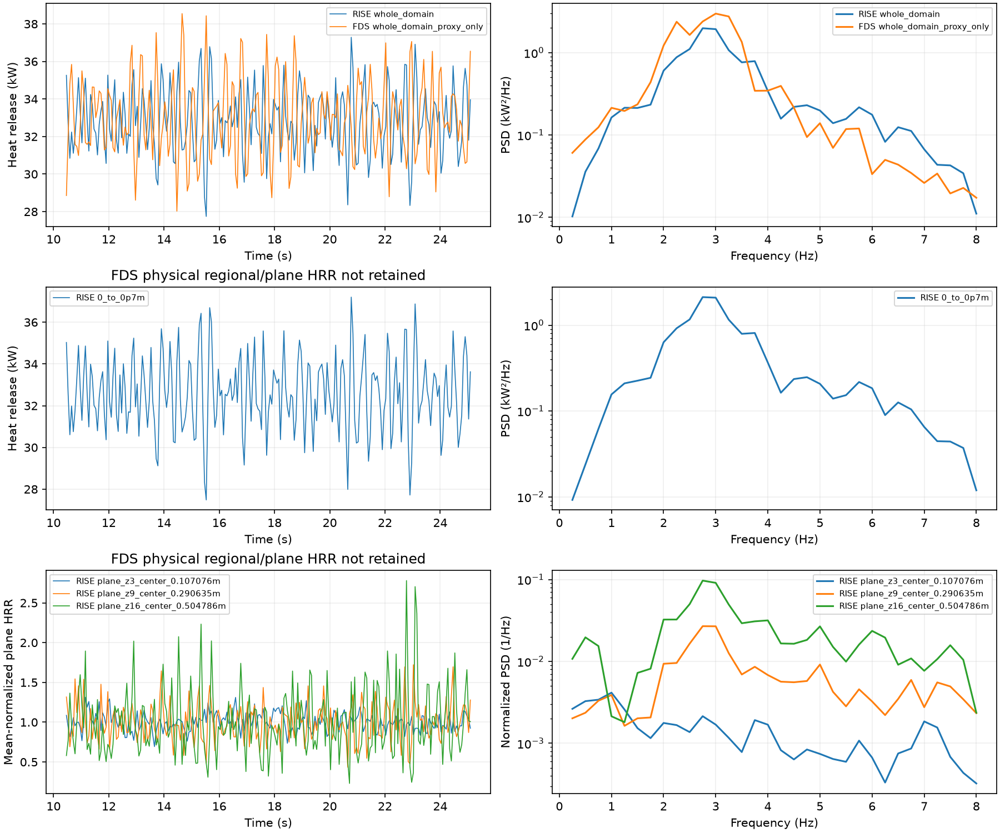

# r259 — inlet density and retained heat-release forcing

2026-10-27. Read-only r251 / LES FDS r258 analysis. No stage advanced, no
simulation launched, and no solver change. **The inlet ratio is a boundary-density
model difference. Whole-domain heat-release fluctuations are broadly comparable;
the requested physical regional/plane FDS comparison is unavailable from the
retained outputs, so no mixing-time/eligibility verdict is justified.**

## 1. Both inlet velocities are native bottom-face values

RISE: retained checkpoint `velocity.component[2][x+69*y]`, the MAC z face at
**z=0**, over the 69 authored burner faces. It is not the first cell-center
velocity, which would average this face and the face at z=dx.

FDS: `W-VELOCITY` devices authored at each same burner-face center, z=0.
The pinned reader selects a face with `K=NINT(ZK)=0`; the gas output returns
native W at that face. No first-cell-center averaging is applied.
[Device indexing](https://github.com/firemodels/fds/blob/FDS-6.11.1/Source/read.f90#L15168-L15180).

The common discrete active area is **69 dx²=0.06457977380 m²** at
**dx=0.03059311607 m**. The nominal 0.30 m circle is 0.07068583471 m²;
the shared pattern normalizes the discrete area to the same total supplied fuel.
That nominal/discrete distinction does not produce a RISE/FDS area mismatch.

At 300 K and 101325 Pa, the RISE methane record gives
**ρ_CH4=0.6516766163 kg/m³**. With LHV=50.02736488 MJ/kg:

    mdot = 33000 / LHV = 0.0006596389812 kg/s
    u_pure = mdot / (rho_CH4 * A_active) = 0.01567392105 m/s

Using the nominal circle instead would give 0.01431995930 m/s, but the active
69-face area is appropriate for the measured native-face mean.

| Native-face mean | Velocity (m/s) | Relative to cold pure-CH4 expectation |
|---|---:|---:|
| Expected pure CH4 | 0.01567392 | — |
| RISE measured | 0.02013114 | +28.44% |
| LES FDS measured | 0.01032218 | −34.14% |

### The formula causing the difference

The RISE projection sets burner momentum equal to the authored gas mass flux
j, then recovers its primitive velocity using the stored dual density:

    rho_dual = 0.5*rho_injected + 0.5*rho_first_gas_cell
    M_face = j
    u_face = M_face/rho_dual

[build_faces](../src/Library/Utilities/FireProductionProjectionMac.mm#L225) and
[setup_velocity](../src/Library/Utilities/FireProductionProjectionMac.mm#L261)
implement those operations. Retained checkpoints verify this formula over
**204 weighted times ×69 faces**: maximum velocity discrepancy is
**3.58×10⁻⁹ m/s**, and imposed momentum differs from j by at most
**4.63×10⁻¹⁰ kg/(m² s)**. The fuel mass flux is not doubled.

FDS instead uses **UN=MFT/RHO_F**. Its wall species/diffusion boundary solve
updates surface mass fractions and then recomputes RHO_F from the surface EOS.
RHO_F is a **wall mixture density**, not the pure-CH4 injection density.
[Mass-transfer boundary implementation](https://github.com/firemodels/fds/blob/FDS-6.11.1/Source/wall.f90#L1396-L1448).
The FDS surface density history itself was not saved; its effective density is
inferred from the prescribed flux and measured velocity, not presented as a
recorded arithmetic density mean.

For the same area-mean flux jbar, define rho_eff=jbar/mean(u). It is
**0.5073895 kg/m³ for RISE** and **0.9895512 kg/m³ for FDS**. Their ratio is
exactly the measured **1.95028 velocity ratio**. These effective densities are
not arithmetic means of instantaneous density. The nonlinear averaging is
retained in the face-by-face calculation.

**Answer:** density definition explains the ratio; neither area nor measurement
location does. RISE really departs from the pure-CH4 speed by **0.00445722 m/s
(+28.44%)**, through its dual-density formula. FDS also uses a different wall
mixture rather than pure-CH4 face density. This establishes a boundary-model
mismatch, not a demonstrated mass-flux error. Calling the RISE choice a physical
boundary bug requires deciding whether the intended boundary primitive velocity
is based on the injected pure gas or a wall mixture/dual-volume state. No
boundary change or physical-cause claim is made here.

## 2. Heat-release forcing that can be measured

Window **10.4660401272–25.0910401272 s**. RISE has 235 float32 `reaction` VDB
frames at 16 Hz. Native cell volumes are integrated; the layer intersecting
0.7 m is included fractionally. RMS uses time-weighted deviations from the mean.
Plane heat release is **integral(q''' dA)**, units W/m; multiplying by dx gives
that finite layer's watts. The few-base-cell HRR histories at center/rim and
these heights are included in the data, without attributing their rates to
unretained eligibility or mixing-time histories.

Welch spectra use the same periodic Hann /64 samples /32 overlap /linear
segment detrending as r257, and sum **1≤f<3 Hz** bins at 0.25 Hz spacing.
The whole-domain FDS HRR CSV contains interval means at nominal 32 Hz; values
are interpolated from interval midpoints to the common 16 Hz times, with the
last interval held through its endpoint. Thus this is a resolved-band
comparison, not an estimate of unresolved within-interval variance.

| Volume | Mean HRR (kW) | RMS / mean | 1–3 Hz power (kW²) |
|---|---:|---:|---:|
| RISE, whole domain | 32.8607 | 5.265% | 1.34768 |
| FDS, whole domain | 32.9876 | 6.206% | 2.17481 |
| RISE, 0–0.7 m | 32.5587 | 5.444% | 1.41842 |
| FDS, 0–0.7 m | unavailable | unavailable | unavailable |

The sampled-frame RISE mean differs slightly from its accepted-step ledger
mean (32.837 kW); this does not replace its accepted fuel balance. Frame total
HRR was independently checked against the earlier r251 frame extraction.
RISE's 0–0.7 m mean contains **99.08% of its sampled total heat**. The equivalent
physical fraction in FDS cannot be measured from the saved data.

| Native RISE plane | Mean (kW/m) | RMS / mean | 1–3 Hz power ((kW/m)²) | FDS |
|---|---:|---:|---:|---|
| 0.107076 m | 63.6009 | 11.078% | 16.5621 | unavailable |
| 0.290635 m | 32.1303 | 23.603% | 18.6063 | unavailable |
| 0.504786 m | 8.63472 | 42.687% | 4.30108 | unavailable |

## Why FDS regional/plane entries are unavailable

r258 saved temperature, velocity, density, thermodynamic divergence and mass
flux planes, but **no physical HRRPUV plane or regional-HRR device histories**.
The restart supplies a single final state, not the requested time history.

Its Smoke3D fire file first averages cell HRR onto nodes, then clips to
**1200 kW/m³** and quantizes to 0–254 before run-length encoding. The top code
begins near 1197.64 kW/m³ because of rounding. All **583 statistics-window
Smoke3D frames** have top-coded nodes, up to 412 in a frame; the saved maximum
is capped at 1200. The decoded whole-domain display field averages only about
**18.05 kW**, against about 33 kW in the physical HRR ledger. This is a lossy
visualization, not a recoverable physical forcing field.
[Smoke3D mapping](https://github.com/firemodels/fds/blob/FDS-6.11.1/Source/smvv.f90#L945-L961).

Neither the unknown heat hidden in top-coded nodes nor the physical plane
histories can be recovered by rescaling this display. Thermodynamic divergence
is also not a substitute for chemical HRR alone. The display audit is retained
as evidence of the limitation; its RMS/PSD is not reported as combustion forcing.

## Decision and remaining input

Whole-domain forcing is broadly comparable: RISE has **84.8% of FDS's normalized RMS** and
**62.0% of its 1–3 Hz HRR power**, rather than the roughly 31.6% velocity-power
ratio at 1 m in r258. This provides no evidence of a fourfold suppression of
*global* chemical forcing. It does not establish equal spatial distribution or
equal plane/regional forcing, since spatial redistribution can cancel in a
whole-domain integral.

**The requested regional decision remains unresolved.** There is no justified
assignment of smoothing to mixing time versus eligibility from these retained
outputs, and no basis for changing the combustion closure. The missing input is
unclipped FDS physical HRR histories for 0–0.7 m and the three native planes.
No new run is launched under this read-only request. The momentum/pressure
time step remains a candidate for the owner's next review, with this forcing
limitation explicit. **Stopped for review; solver unchanged.**

CSV/JSON/plot: `docs/data/fire_r259/`. Native extraction and display-audit files:
`/Volumes/SSD/RISE/fire_production_calibration/r259_inlet_forcing/`.
