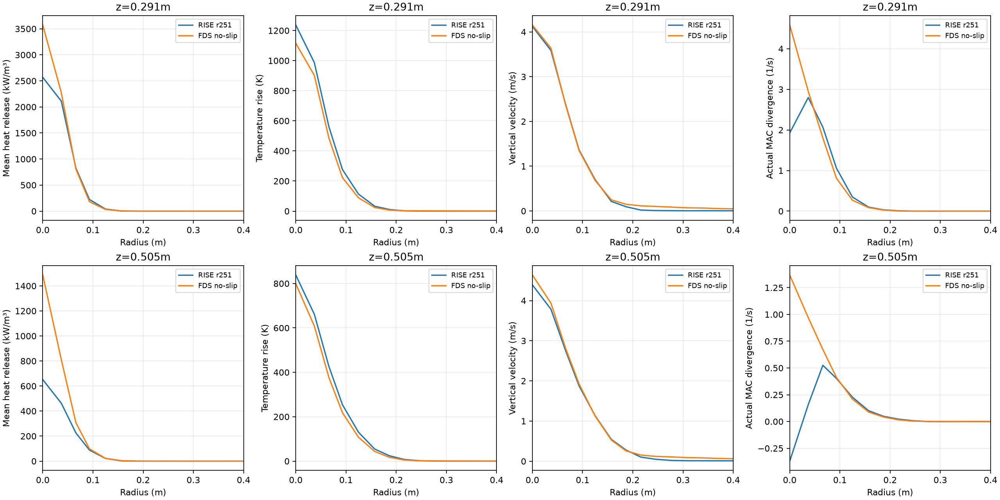

# r265 — retained flame structure, r251 versus no-slip FDS

Read-only comparison requested alongside production adoption of centered
momentum. No solver step was advanced and no simulation was run for this
analysis. Both existing runs use the same native grid; the selected cell
centers are0.290635m and0.504786m. The statistics window is
10.4660401272–25.0910401272s.

## Reaction-zone extent

**RISE's reaction zone is not narrower by the requested90%-heat definition.**
The interpolated radius is slightly larger in RISE at both heights, with
all differences below one quarter of a grid cell. The direct discrete
cell-center quantiles are identical between the codes. This is no resolved
reaction-zone narrowing in r251 at either station.

|Height|RISE R90|No-slip FDS R90|RISE/FDS difference|RISE/FDS discrete cell-center R90|
|---:|---:|---:|---:|---:|
|0.291m|0.09057m|0.08295m|+9.18%, +0.00762m (0.249dx)|0.08653 /0.08653m|
|0.505m|0.10386m|0.09745m|+6.57%, +0.00640m (0.209dx)|0.09674 /0.09674m|

R90 is the radial extent containing90% of the **time-mean plane heat
release**, integrated using actual Cartesian-cell areas in radial annuli.
The annulus crossing90% is partially filled with linear interpolation in
radius squared. Its boundaries are0.07648–0.10708m at both stations and in
both codes. The subcell estimate depends on this interpolation; the identical
discrete quantiles make that resolution limitation explicit. The CSV also
reports D90=2R90 (diameter). This is different from temperature/velocity
half-widths or an instantaneous flame contour.

## Radial profiles

The four requested profiles are overlaid: physical heat release rate,
temperature rise above300K, centered vertical velocity, and actual MAC
velocity divergence. Complete annular data are in
[data/fire_r265/radial_structure.csv](data/fire_r265/radial_structure.csv).
The signed mean divergence and mean absolute divergence are saved separately.
FDS's thermodynamic divergence target is also saved but is not substituted
for the measured MAC divergence.

|Height|Quantity|RISE r251|No-slip FDS|
|---:|---|---:|---:|
|0.291m|Plane-integrated mean HRR per height|32.130kW/m|33.266kW/m|
||Center mean HRR|2568.4kW/m³|3572.3kW/m³|
||Center temperature rise|1236.7K|1115.9K|
||Center vertical velocity|4.123m/s|4.154m/s|
||Center signed mean MAC divergence|1.926s⁻¹|4.585s⁻¹|
|0.505m|Plane-integrated mean HRR per height|8.635kW/m|13.205kW/m|
||Center mean HRR|651.2kW/m³|1486.9kW/m³|
||Center temperature rise|838.2K|799.2K|
||Center vertical velocity|4.391m/s|4.637m/s|
||Center signed mean MAC divergence|−0.370s⁻¹|1.368s⁻¹|

Thus RISE has lower mean heat release at these planes, especially0.5m,
without having a smaller90%-heat radial extent. Its temperature is higher
at the center, while its center velocity is close at0.29m and lower at0.5m.
Mean divergence differs, including the sign at the0.5m center. These
profiles locate differences; they do not establish which source, pressure
coupling or eligibility term causes them.

## Eligibility accounting — checkpoint-sampled source reconstruction

RISE heat release by **pre-source** ignition class:

|Region|Already above600K|Cold edge-waived|Cold floor-holder exception|
|---|---:|---:|---:|
|0.291m plane|93.837%|6.163%|0%|
|0.505m plane|86.978%|13.022%|0%|
|Below1m|86.891%|13.105%|0.0037%|
|Whole domain|86.854%|13.143%|0.0037%|

These are heat-weighted fractions from **204 retained beginning-state source
reconstructions**, not a complete historical all-step classification log.
For each retained checkpoint, the offline probe uses the actual next accepted
timestep from r251's final history, recomputes the original mixing-time
coefficient from the retained state/native MAC velocity, and calls the
unchanged canonical frozen-source producer. It advances no momentum,
transport or projection stage. The case identity is checked against r251.
Cold cells counted as edge-waived have T<=600K and pass the actual seeded
parcel-edge eligibility graph; warm cells have T>600K before source
construction. Cold floor-holder heat is separated rather than mislabelled
as an edge waiver. No cold source heat is left unclassified.

This timing distinction matters: retained VDB temperature is the accepted
post-step temperature, whereas its reaction field is the preceding source
packet. A direct mask of reaction by that temperature would not identify the
original eligibility class. Source-only reconstruction avoids that error.
The203 non-endpoint reconstructions match the saved next-step source budget
within **8.88e-8 maximum relative difference** (RMS5.87e-8). The final endpoint
has no actual next step, so it reuses the last accepted timestep and is
flagged separately; excluding it changes the0.291/0.505m edge fractions
by0.0049/0.0016 percentage points, respectively.

The original retained-checkpoint quadrature weights are reused. Fractions
are weighted category heat divided by weighted total heat, not averages
of instantaneous percentages. Temporal-half edge fractions are6.101/6.223%
at0.291m and12.745/13.303% at0.505m. These are sampling-sensitivity checks,
not ensemble confidence intervals. Reconstructed mean whole-domain HRR is
32.8588kW,0.0652% above the exact all-step32.8374kW; plane source powers
are1.49/0.53% above the separate235-frame means. Thus the sparse support
is quantified rather than presented as exact full-history accounting.

**Conclusion:** most heat at both stations comes from cells already above600K,
while the one-cell waiver contributes6–13%. The requested90%-heat reaction
zone is not narrower than no-slip FDS, so these data do not support the
specific claim that parcel-edge eligibility confines a narrower RISE zone.
An ignition-class fraction alone is not a counterfactual proof of the rule's
effect on radial width; no chemistry or eligibility change was tested here.

Full fractions, per-height means, source-budget checks and input/source hashes
are in [eligibility_results.json](data/fire_r265/eligibility_results.json),
[eligibility_summary.csv](data/fire_r265/eligibility_summary.csv),
[eligibility_height.csv](data/fire_r265/eligibility_height.csv) and
[eligibility_budget_check.csv](data/fire_r265/eligibility_budget_check.csv).
The native source-only probe build is warning-free. Independent review found
no P1 in source lineage, classification or weighting.

## Measurement and verification

RISE HRR is extracted from all235 retained VDB `reaction` fields at both
planes with trapezoidal weights from actual `frame_times.csv`. Its mean
plane integrals agree with the independent r259 frame-integral extraction
to floating-point roundoff (relative difference0 and4.44e-16). RISE T/w use
the existing r254235-frame means. Actual RISE divergence uses the existing
204 nonzero retained-checkpoint quadrature weights from the r258/r254
native MAC probe; it has the same window but a different time sample grid.
Do not treat pointwise small divergence differences as an exactly synchronized
history comparison.

FDS uses unquantized physical float32 slices from the completed no-slip
r263 run. HRRPUV is converted fromkW/m³ toW/m³. Temperature is converted
from Celsius to Kelvin; vertical velocity is centered from adjacent native
faces. Divergence is reconstructed from native U/V/W face differences,
not from the thermodynamic target. Actual slice timestamps are integrated,
with the known binary32 endpoint aligned to the requested window endpoint.
Profiles use dx-wide annuli, with actual Cartesian-cell counts/areas.

`tools/fire/r265_reaction_planes.cpp` is a standalone OpenVDB reader and
links no RISE solver objects. Its build emitted two warnings from the
third-party OpenVDB `[[assume]]` macro, none from the reader's own code;
those headers are outside the repo's warning ownership. Source/input hashes,
full-precision widths and conventions are in
[data/fire_r265/structure_results.json](data/fire_r265/structure_results.json).
Large native fields and the extracted cell map remain under
`/Volumes/SSD/RISE/fire_production_calibration/r265_structure/`.
No production code was changed by this read-only analysis.
