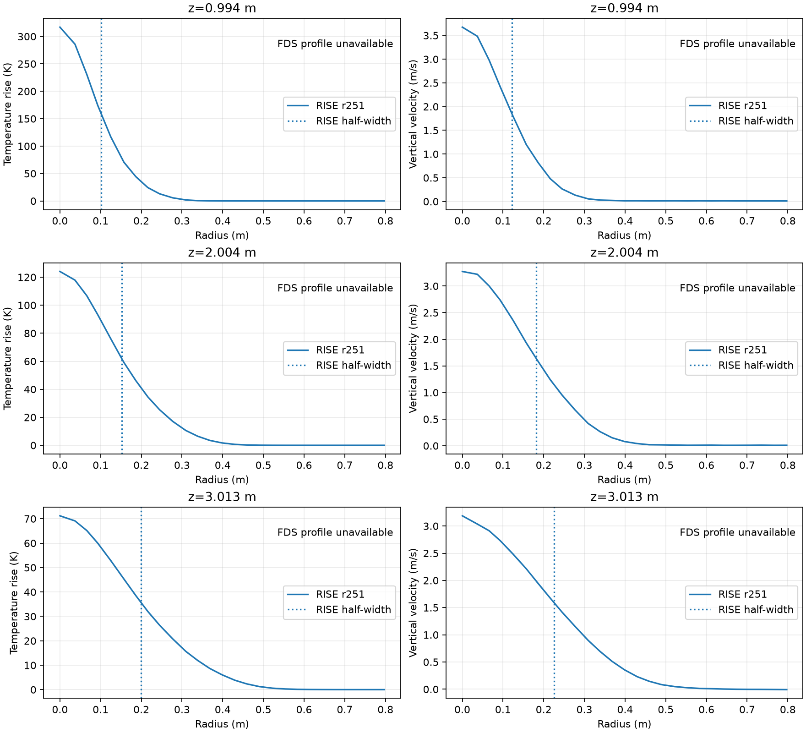
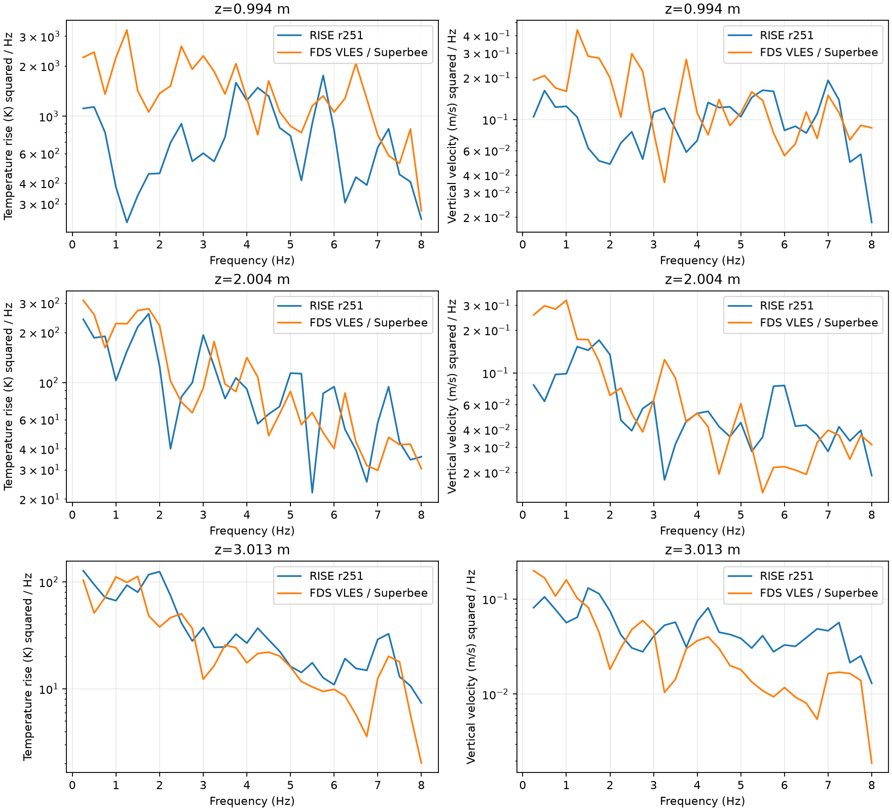

# r257 — retained r251/FDS comparison before reconstruction A/B

2026-10-20. Read-only comparison over 10.4660401272–25.0910401272 s.
No new simulation or production source change produced these measurements.

## Radial profiles: a retained-data gap

r251's temperature-rise and vertical-velocity radial profiles are available,
with annular means and first outward half-centerline crossing as in r254:

| Native height (m) | Temperature half-width (m) | Velocity half-width (m) | FDS half-widths |
|---|---:|---:|---|
| 0.994 | 0.10175 | 0.12261 | unavailable |
| 2.004 | 0.15164 | 0.18194 | unavailable |
| 3.013 | 0.19975 | 0.22518 | unavailable |

The matched FDS run saved centerline instantaneous temperature/velocity devices
and cross-sectional **mass-flux** slices. It did not save off-axis T or w slices,
volume fields or off-axis devices. Its Smoke3D products are soot density, HRRPUV
and effective flame temperature for visualization; none supplies the requested
thermodynamic-temperature and velocity radial histories. Its single final
restart is not a statistics-window history. Mass flux alone cannot determine
T and w separately. **FDS radial overlays and half-widths cannot be measured
from the retained run. Edge smearing is therefore untested.** No inferred
Gaussian FDS profile is substituted and no FDS rerun is launched.

## Centerline spectra

235 r251 VDB samples at 16 Hz; FDS instantaneous devices at nominal 32 Hz (actual event times are irregular), interpolated to
the same times. Adjacent FDS native w faces are averaged at each cell center.
Welch density spectra use periodic Hann windows, 64 samples, 32 overlap,
linear detrending per segment: six overlapping four-second segments, 0.25 Hz
bins. Spectra CSV includes absolute PSD and PSD divided by squared mean.
FDS's final printed time is rounded by 0.127 microseconds and aligned to the
known final event (inside its printed precision). There is no anti-alias filter
in this common-grid comparison; near-Nyquist differences warrant caution.
The manual Welch calculation agrees with SciPy on an independent seeded signal.
The extraction's time-weighted centerline means reproduce r254 to rounding.

| Height (m) | θ RMS/mean, RISE / FDS | w RMS/mean, RISE / FDS | RISE/FDS absolute θ power, 1–3 Hz | RISE/FDS absolute w power, 1–3 Hz | RISE/FDS absolute w power, 3–6 Hz |
|---|---:|---:|---:|---:|---:|
| 0.994 | 0.249 / 0.534 | 0.254 / 0.356 | 0.259 | 0.298 | 0.995 |
| 2.004 | 0.243 / 0.452 | 0.221 / 0.320 | 0.737 | 0.821 | 0.882 |
| 3.013 | 0.266 / 0.474 | 0.200 / 0.290 | 1.153 | 0.995 | 1.959 |

These are sample RMS/means; radial half-widths above use temporal trapezoidal
means. RISE has much less 1–3 Hz power at 1 m. It does **not** exhibit a uniform
high-frequency roll-off: at 3 m its absolute w power in 3–6 Hz is larger.
Normalized power is also retained, but higher RISE means themselves reduce that
normalization. Neither this short record nor normalization proves a numerical
damping mechanism. The spectra differ, rather than matching with only mean
shifts. Do not use the missing edge data to assert scalar smearing.

## Two code/documentation facts

**RISE interior advection is kinetic-energy-conserving in the semidiscrete
compatible sense.** `fct_compatible_stage_rate` uses the arithmetic velocity
factor on a shared restricted accepted gas mass flux F. On an interior dual
face, with the same dual-density continuity, the pair's energy contribution is

    F (uR−uL)(uL+uR)/2 − F (uR²−uL²)/2 = 0.

This holds for the centered velocity factor even when the scalar carrier is
limited. Thus scalar limiting does not create an explicit donor-cell velocity
diffusion term. It changes scalar transport and the mass carrier, which can
change dynamics. This is not exact conservation for the fully discrete Heun,
projection, SGS, source and open-boundary update. The relevant code is
`FireProductionAdvectionMac.mm`, `fct_compatible_stage_rate` (around 2020),
`fct_extract_gas_density` and `fct_restricted_cell_gas` (around 2135).
The design §3.7 statement must be read with this semidiscrete qualification;
its generic “limiter blending adds ... dissipation” is not an implemented
upwind-velocity term. See also the explicit identity in r254.

**FDS 6.11.1 LES scalar default is CHARM. Its VLES default is Superbee.**
The matched FDS run is VLES and actually used Superbee. Verified against
[TRG, Mass/Species, Flux Limiters](https://github.com/firemodels/fds/blob/FDS-6.11.1/Manuals/FDS_Technical_Reference_Guide/Mass_Chapter.tex#L68-L114)
and [pinned read.f90](https://github.com/firemodels/fds/blob/FDS-6.11.1/Source/read.f90#L1858-L1868).
These names are not interchangeable. For CHARM, upstream difference Δup and
local difference Δloc must have the same sign; with s=Δloc/Δup, the face
increment is B(s)Δup/2, B(s)=s(3s+1)/(s+1)². Negative velocity reverses which
neighbor difference is upstream. Applying CHARM with MC's symmetric arguments
without that reversal would be incorrect.

## Decision

The measured 1 m spectral deficit satisfies the owner's broad spectral
condition for a **discriminating reconstruction A/B**, without establishing MC
as its cause. Select **CHARM, the explicit LES default requested**, not the
matched VLES run's Superbee. Apply only the scalar reconstruction change in an
external diagnostic build, retain affine-coordinate projection, FCT bounds,
compatible momentum, source, timesteps/event policy and focusing protection.
Use completed r256 as A (same 15.0187 s checkpoint and exactly four seconds),
and run B from that checkpoint with the same observer and compare 1/2/3 m mass
flux. No bit-identity gate. This is a checkpoint diagnostic, not a production
change or a new accepted from-zero result. B launched at **2026-10-20 05:08 PDT**, with 2,432 additional accepted steps
planned (about four seconds). The independent review found no P1/P2 in the
CHARM formula or build isolation; the external build produced zero warnings.
If B changes timestep sizes, reduce both runs over their common physical
interval, not unequal windows. The production source and objects remain
untouched. Build hashes and the exact diagnostic patch are committed under
`docs/data/fire_r257/`; runtime log/status are in
`/Volumes/SSD/RISE/fire_production_calibration/r257_charm_ab/`.
**A/B results pending; stop for review when they are available.**
